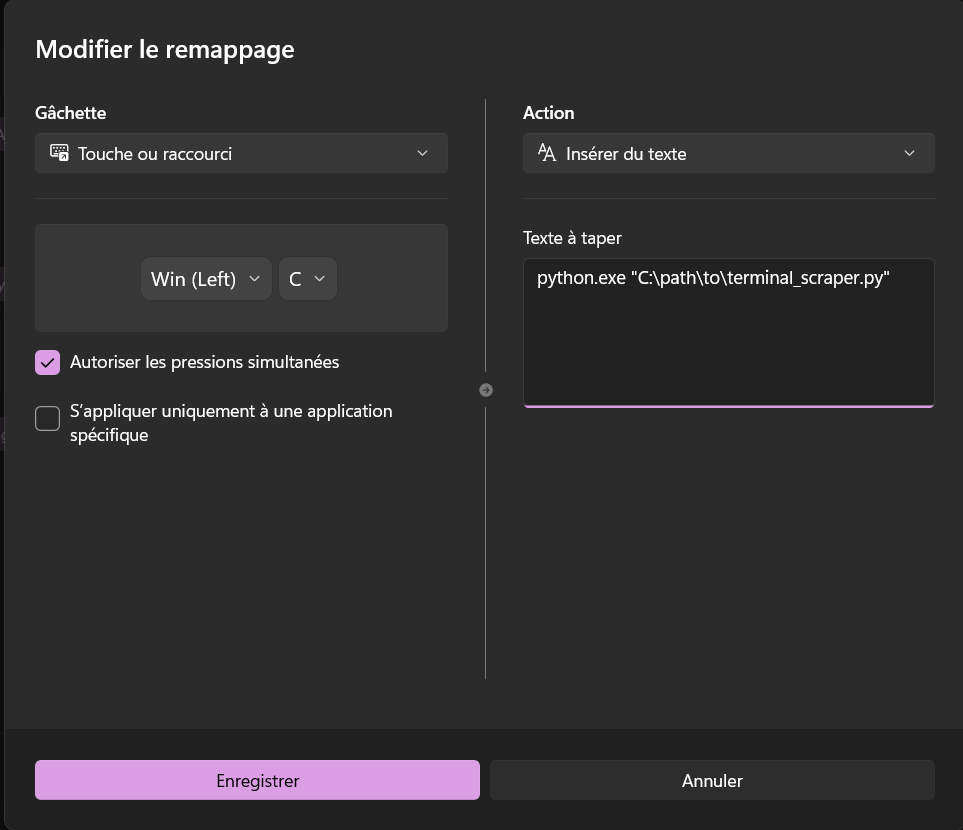

# Terminal Scraper (Windows)

A fast, lightweight Python script for Windows that copies **only your last executed terminal command and its output** directly to your clipboard. 

Built for quickly grabbing terminal logs, tracebacks, or command outputs to paste into AI chats, documentation, or GitHub issues without scrolling up with your mouse.

---

## How It Works

1. Checks that your active window is a supported terminal (`WindowsTerminal.exe`, `powershell.exe`, `pwsh.exe`, `cmd.exe`, or `Code.exe`).
2. Copies the terminal buffer and immediately scrolls back to the bottom so your view doesn't jump.
3. Scans the text **from bottom to top** using regex to find the last command you ran, slices out the command + output, and places it in your clipboard.
4. Exits immediately (0% background CPU/RAM usage).

---

## Requirements

Install the required Python packages:

```bash
pip install pyperclip psutil pywin32 pyautogui
```

### Windows Terminal Setup
If you use **Windows Terminal**, make sure `Ctrl + Shift + A` is set to **Select all**:
1. Open Windows Terminal Settings (`Ctrl + ,`).
2. Go to **Actions**.
3. Bind **Select all** to `Ctrl + Shift + A` (and ensure **Copy** is `Ctrl + Shift + C`).

---

## How to Use with a Shortcut (Microsoft PowerToys)

To trigger the script anytime without running a background loop:

1. Open **PowerToys** → **Keyboard Manager** → **Remap a shortcut**.
2. Choose your shortcut (e.g., `Win + C`).
3. Set **Action** to **Send Text** (`Insérer du texte`) and paste the path to your script:
   ```powershell
   python.exe "C:\path\to\terminal_scraper.py"
   ```
4. Press your shortcut in the terminal and hit **Enter**—your last command and its output are now in your clipboard.


5. You can set **Target app** to `WindowsTerminal.exe` (so the shortcut only triggers inside your terminal).

---

## Example

If your terminal screen has a long history, running the scraper grabs **only** the last command block:

```text
PS C:\Users\Dev\Projects\my-app> dir


    Directory: C:\Users\Dev\Projects\my-app


Mode                 LastWriteTime         Length Name
----                 -------------         ------ ----
d-----         10-Oct-26   2:15 PM                src
d-----         10-Oct-26   2:15 PM                tests
-a----         12-Oct-26   4:30 PM           1420 main.py
-a----         12-Oct-26   4:32 PM            850 README.md
```

---

## Experimental (macOS / Linux / Other Shells)

An experimental cross-platform version with broader regex patterns (`zsh`, `bash`, `venv` prefixes, and macOS/Linux shortcuts) is available in the [`/experimental`](./experimental) folder. 

> **Note:** The experimental version has **not** been tested on macOS or Linux environments. Feel free to test it on your setup and open a PR if you improve it!
